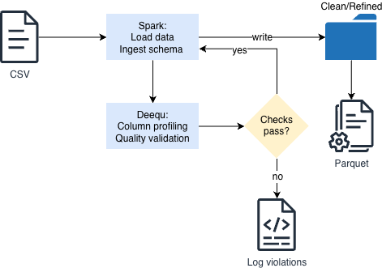

# Automated Data Quality Pipeline with PySpark and PyDeequ

An end-to-end Python-based data pipeline demonstrating automated **Data Profiling**, programmatic **Data Quality (DQ) validation**, and **conditional routing** using **PySpark 4.1.3** and AWS **PyDeequ**.


## Project Overview
In modern data architectures, silent data corruption can derail downstream analytics and ML models. This project demonstrates a programmatic way to enforce data quality thresholds directly within an Apache Spark pipeline before data hits production storage.

The application ingests raw Electric Vehicle data, profiles the data profile dynamically, runs strict constraint validation checks, and performs **conditional data routing** based on the data health score:
* **Pass:** Clean data is written out to an optimized, partitioned Parquet storage layer.
* **Fail:** Invalid batches bypass production storage entirely; the application halts processing and logs the exact constraint violations directly to `stdout` for troubleshooting.


## What is Deequ?
**Deequ** is an open-source data quality verification library built on top of Apache Spark, originally developed and used internally by **Amazon** to monitor large-scale production datasets. 

### Why use Deequ / PyDeequ?
* **Scalability:** Unlike traditional validation tools that pull data into memory (like Pandas), Deequ translates data quality constraints directly into optimized **Spark SQL aggregation queries**. This allows it to compute metrics on billions of rows seamlessly.
* **Automated Profiling:** It can automatically scan datasets to suggest validation rules based on data distribution, completeness, and inferred data types.
* **State Management:** Deequ supports saving computed data metrics over time. This enables incremental data validation and anomaly detection by comparing new data batches against historical baselines.

**PyDeequ** is the official Python interface that allows data engineers to leverage this powerful Scala/Java ecosystem directly inside native PySpark pipelines.


## Architecture & Workflow

1. **Ingestion & Schema Enforcement:** Loads raw CSV data while enforcing a structured Spark schema safely.
2. **Exploratory Data Profiling:** Computes baseline advanced statistics (completeness, data types) across columns using the `ColumnProfilerRunner`.
3. **Data Quality Suite Validation:** Executes multiple verification checks simultaneously using PyDeequ's engine.
4. **Conditional Processing (Clean Zone / Error Logging):** 
   * **Success:** Triggers a dynamic multi-column partition write format to the clean zone.
   * **Failure:** Bypasses all storage steps entirely, isolating the problem in-memory and surfacing exact assertion warnings to the console.

### Architecture Design & Components

The architecture follows a classic **decoupled, data-driven validation pattern** processed completely in-memory using distributed computing clusters. It isolates computational heavy-lifting from structural storage layers:

<div align="center">
  
</div>

#### 1. Decoupled Ingestion & Structural Typing
* **Source Agnostic Input:** The entry layer accepts data from underlying structural assets (such as local systems, network attach mounts, or cloud object stores like AWS S3).
* **Strict Type Mapping:** Ingested streams pass through a fixed `StructType` compilation schema mapping instead of guessing formats. This catches severe structural variations before executing computations.

#### 2. Unified Computational Engine (PySpark & PyDeequ)
* **Distributed Profiling Engine:** Data transitions into the `ColumnProfilerRunner` framework, calculating metadata footprints like completeness, data distribution, and estimated data types natively without edge memory constraints.
* **Constraint Evaluation Engine:** Parallelized evaluation matrices process target datasets via a `VerificationSuite`. The engine converts your Python criteria into highly optimized Spark aggregation jobs executed horizontally across the cluster environment.

#### 3. Conditional Storage & Audit Routing
* **Optimized Silver/Gold Output:** If all threshold matrices cross validation requirements seamlessly, data streams are persisted as compressed **Apache Parquet files**. Records are physically arranged and indexed based on high-order dimension groupings (`ModelYear` and `Make`) to dramatically speed up analytical querying downstream.
* **Fault Logging (No Storage Route):** Any batch generating runtime assertions fails the constraint threshold and bypasses storage targets completely. It drops the execution flow before writing files to secure reporting layers from upstream anomalies, throwing actionable alerts into stdout logs instead.


## Technical Stack
* **Language:** Python
* **Data Processing Framework:** Apache Spark (PySpark 4.1.3)
* **Data Quality Framework:** AWS PyDeequ (Python API for Amazon Deequ)
* **Storage Formats:** Comma-Separated Values (CSV), Apache Parquet


## Data Quality Rules Enforced

The following automated validation checks are evaluated dynamically on the incoming stream:

| Column | Validation Rule | Severity Level | Business Context / Justification |
| :--- | :--- | :--- | :--- |
| **`VIN`** | `isUnique` | Error | Evaluates unique constraints; Vehicle Identification Numbers must not duplicate. |
| **`ElectricRange`** | `satisfies(0 <= range < 400)` | Error | Custom SQL boundary validation preventing extreme anomalies. |
| **`City`** | `isComplete` | Error | Mandates non-null geolocations necessary for geographic indexing. |
| **`State`** | `isComplete` | Error | Mandates non-null geographic indexing fields. |
| **`County`** | `isComplete` | Error | Mandates non-null geographic indexing fields. |


## Repository Structure

The project follows a production-ready, modular Poetry package layout:


```text
.
├── README.md
├── data/
│   ├── Electric_Vehicle_Population_Data.csv         # Raw incoming dataset with structural & value anomalies
│   └── Electric_Vehicle_Population_Data_Fixed.csv   # Cleansed dataset ensuring 100% PyDeequ verification pass
├── images/
│   └── blueprint.png                                # End-to-end pipeline architecture diagram
├── poetry.lock                                      # Pinlocked dependency tree ledger
├── pyproject.toml                                   # Poetry build system and application configurations
├── src/
│   └── deequ_pyspark_dq/
│       ├── __init__.py
│       └── pipeline.py                              # Core PySpark execution pipeline driver script
└── tests/                                           # Test orchestration suite
    ├── __init__.py
    └──deequ_pyspark_dq 
        ├── __init__.py
        ├── conftest.py                              # Shared, session-scoped local Spark & PyDeequ fixture
        └── test_pipeline.py                         # Unit tests for clean, out-of-bounds, and duplicate data
```


## Dataset Overview & Quality States

The project uses the *Electric Vehicle Population Data* domain to replicate real-world data profiling scenarios. Under the `data/` directory, the files represent two distinct processing lifecycle stages:

### 1. `Electric_Vehicle_Population_Data.csv` (Simulated Production Errors)
This file mimics an unvetted batch containing silent operational data anomalies. Feeding this straight to analytics pipelines would poison metrics due to:
* **Constraint Violations:** Out-of-bounds metrics in `ElectricRange` (e.g., legacy test values or manual insertion spikes reaching `450`).
* **Completeness Failures:** Corrupted geographical rows missing fundamental indexing keys across `City`, `State`, and `County`.
* **Pipeline Action:** Processing this file intentionally triggers a validation failure state. It prevents the script from creating or outputting a final production Parquet target, routing error summaries directly to the console logs.

### 2. `Electric_Vehicle_Population_Data_Fixed.csv` (Cleansed / Reference Dataset)
This file represents the remediated, structurally verified equivalent where anomalies have been filtered or patched upstream:
* All geographical keys are populated (`isComplete == 1.0`).
* `ElectricRange` constraints fully conform to legitimate threshold metrics (0 <= range < 400).
* **Pipeline Action:** This file successfully achieves a `Success` state from the `VerificationSuite`, triggering the distributed multi-column Parquet extraction block.


## Environment Variables & Configuration

The application abstracts critical configuration settings to environment variables, making it cloud-native and ready for orchestration tools like Apache Airflow or AWS Glue:

```bash
export CSV_SOURCE_PATH="/path/to/your/input/dataset.csv"
export PARQUET_OUTPUT_PATH="/path/to/your/output/storage/"
```


## Production Output Strategy

When data successfully satisfies all PyDeequ constraints, it is dynamically re-structured to be persisted. The pipeline writes to an **Apache Parquet format** using an overwrite strategy partitioned hierarchically:

```text
parquet_output_root/
  ├── ModelYear=2024/
  │    ├── Make=TESLA/
  │    │    └── part-00000.parquet
  │    └── Make=RIVIAN/
  │         └── part-00001.parquet
  └── ModelYear=2025/
```

This layout optimizes querying performance for downstream analytical aggregations filtering on year and manufacturer metadata.


## Logging & Auditing

The system uses structured logging to provide clear observability into pipeline runs:

* **Profiling Auditing Output Example:**
```text
26/10/17 18:51:20 INFO DeequPySparkDQ: Column: ElectricVehicleType | Completeness: 1.0 | DataType: String
26/10/17 18:51:20 INFO DeequPySparkDQ: Column: ElectricRange | Completeness: 0.9999814994338827 | DataType: Integral
26/10/17 18:51:20 INFO DeequPySparkDQ: Column: VIN | Completeness: 1.0 | DataType: String
26/10/17 18:51:20 INFO DeequPySparkDQ: Column: Make | Completeness: 1.0 | DataType: String
26/10/17 18:51:20 INFO DeequPySparkDQ: Column: County | Completeness: 0.9999629988677654 | DataType: String
26/10/17 18:51:20 INFO DeequPySparkDQ: Column: ModelYear | Completeness: 1.0 | DataType: Integral
26/10/17 18:51:20 INFO DeequPySparkDQ: Column: City | Completeness: 0.9999629988677654 | DataType: String
26/10/17 18:51:20 INFO DeequPySparkDQ: Column: State | Completeness: 1.0 | DataType: String
```

* **Failure Route Output Example:**
```text
+--------------+-----------------------------------------------------------------------------------------------------------------------+-----------------+---------------------------------------------------------------------+
|check         |constraint                                                                                                             |constraint_status|constraint_message                                                   |
+--------------+-----------------------------------------------------------------------------------------------------------------------+-----------------+---------------------------------------------------------------------+
|DeequPySparkDQ|ComplianceConstraint(Compliance(Valid ElectricRange value,ElectricRange >= 0 and ElectricRange < 400,None,List(),None))|Failure          |Value: 0.9999814994338827 does not meet the constraint requirement!  |
|DeequPySparkDQ|UniquenessConstraint(Uniqueness(List(VIN),None,None))                                                                  |Failure          |Value: 0.011255744425779429 does not meet the constraint requirement!|
|DeequPySparkDQ|CompletenessConstraint(Completeness(City,None,None))                                                                   |Failure          |Value: 0.9999629988677654 does not meet the constraint requirement!  |
|DeequPySparkDQ|CompletenessConstraint(Completeness(County,None,None))                                                                 |Failure          |Value: 0.9999629988677654 does not meet the constraint requirement!  |
+--------------+-----------------------------------------------------------------------------------------------------------------------+-----------------+---------------------------------------------------------------------+
```


## Automated Unit Testing

To ensure pipeline stability and validate the data routing logic, the repository includes a suite of unit tests built on pytest.
The testing architecture uses a session-scoped fixture (tests/conftest.py) that spins up an isolated, local Spark 4.1.3 engine instance.

>⚠️ PySpark 4.1.3 Note: Ensure your conftest.py explicitly passes the correct Scala 2.13-compatible Deequ fat-JAR coordinates or path inside your .config("spark.jars.packages", ...) block to prevent JVM/Scala version mismatches.

To ensure pipeline stability and validate the data routing logic, the repository includes a suite of unit tests built on **pytest**. 

The testing architecture uses a **session-scoped fixture** (`tests/conftest.py`) that spins up an isolated, local Spark engine instance preconfigured with the Amazon Deequ Java dependencies. This allows tests to run rapidly in memory without restarting JVM containers repeatedly.

The suite asserts three vital pipeline scenarios inside `tests/test_pipeline.py`:
1. **`test_pipeline_passes_with_clean_data`**: Confirms that perfect records achieve a `Success` validation status block.
2. **`test_pipeline_fails_with_invalid_electric_range`**: Validates that out-of-bounds metrics (e.g., values ≥ 400) accurately trip runtime failure signals.
3. **`test_pipeline_fails_with_duplicate_vin`**: Verifies that primary key identity collisions (non-unique `VIN` rows) are intercepted cleanly.


## How To Run

1. **Clone the repository:**

	```bash
	git clone git@github.com:russochecco/deequ-pyspark-dq.git
	cd deequ-pyspark-dq
	```

2. **Install project environment dependencies using Poetry:**

	```bash
	poetry install
	```

3. **Run the automated unit test suite:**

	```bash
    poetry run python -m pytest tests/ -v
	```

4. **Execute the production pipeline modules:**
	
	```bash
	# For testing the success branch:
	export CSV_SOURCE_PATH="data/Electric_Vehicle_Population_Data_Fixed.csv"
	export PARQUET_OUTPUT_PATH="data/output/silver_ev_table"
	poetry run python src/deequ_pyspark_dq/pipeline.py

	# For testing the failure/quarantine isolation branch:
	export CSV_SOURCE_PATH="data/Electric_Vehicle_Population_Data.csv"
	poetry run python src/deequ_pyspark_dq/pipeline.py
	```
